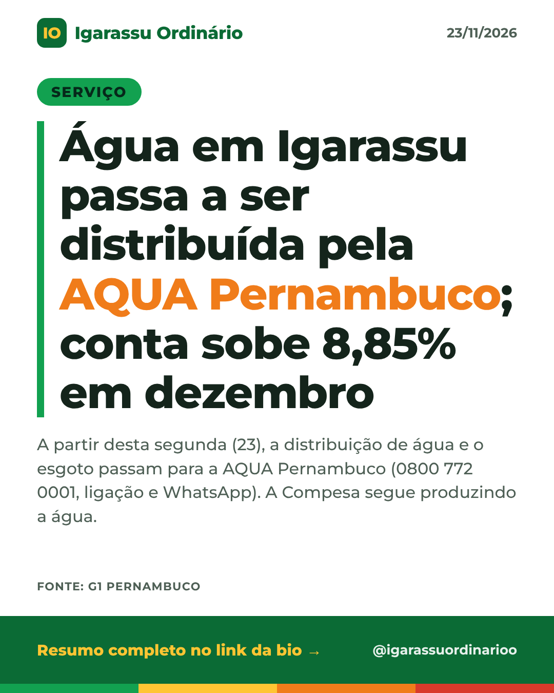
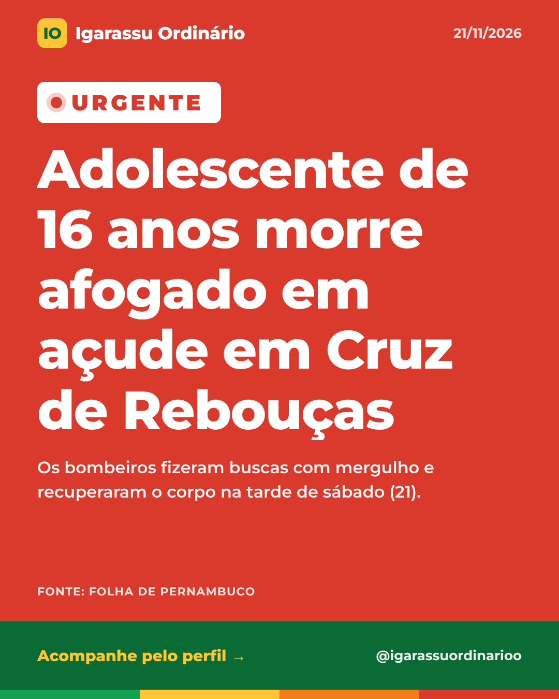

# Inserções — Igarassu Ordinário

Kit de peças prontas com a identidade do portal: **verde, amarelo, laranja e vermelho, fundo branco, Montserrat, sem azul**, e a faixa de quatro cores como assinatura. Para pedir uma peça, basta escrever no chat do Claude, por exemplo:

> "Faz um **feed-noticia** da matéria 175"
> "Preciso de um **urgente** sobre: tiroteio no centro, sem vítimas, fonte PM"
> "Monta um **carrossel** explicando a mudança da água, 3 slides"
> "**Publi** feed + story pro Mercadinho X, oferta tal, WhatsApp tal, segue a foto"
> "**Banners** do site pro anunciante Y"

O Claude escreve o pedido em `insercoes/pedidos/`, gera as imagens e manda os arquivos prontos.

## Catálogo

| Código | Para quê | Tamanho |
|---|---|---|
| `feed-noticia` | Post de notícia, com ou sem foto | 1080×1350 |
| `feed-urgente` | Plantão / urgente (fundo vermelho) | 1080×1350 |
| `story-noticia` | Story, status do WhatsApp, capa de Reels | 1080×1920 |
| `carrossel` | Capa + slides explicativos + slide "Siga" | 1080×1350 (várias) |
| `feed-servico` | Utilidade pública: telefones, horários, prazos | 1080×1350 |
| `feed-agenda` | Evento com data, hora, local e entrada | 1080×1350 |
| `feed-frase` | Frase / declaração de alguém | 1080×1350 |
| `feed-nota` | Nota, comunicado, errata, nota de pesar (`"sobrio": true`) | 1080×1350 |
| `feed-siga` | Slide "Siga o perfil" avulso | 1080×1350 |
| `publi-feed` | Publicidade de anunciante no feed | 1080×1350 |
| `publi-story` | Publicidade de anunciante no story | 1080×1920 |
| `publi-anuncie` | Chamada "Anuncie aqui" para vender espaço | 1080×1350 |
| `banner-300x250` | Banner da lateral do site | 600×500 (2x) |
| `banner-728x90` | Banner horizontal, computador | 1456×180 (2x) |
| `banner-320x100` | Banner de celular | 640×200 (2x) |
| `og-materia` | Imagem que aparece ao compartilhar link | 1200×630 |
| `capa-destaque` | Capas dos destaques do Instagram | 1080×1920 (várias) |
| `perfil` | Foto de perfil | 1080×1080 |

Exemplos prontos de cada modelo: pasta [`catalogo/`](catalogo/). Os pedidos que geraram esses exemplos ficam em [`exemplos/`](exemplos/).

### Notícia




### Publicidade


## Regras da identidade

- **Cor por categoria** (igual ao site): Cidade = verde-escuro `#0B6B35` · Serviço = verde `#12A150` · Comércio Local = laranja `#F07C1A` · Cultura e Eventos = amarelo `#FFC533` · Segurança = vermelho `#D93A2B`.
- Texto `#14241B`, texto suave `#4E5F55`, fundo claro `#F1F8F3`. **Nunca azul.**
- Fonte Montserrat (500 a 900), títulos em 800.
- Selo **IO** (verde-escuro com letras amarelas) + "Igarassu Ordinário" no topo de toda peça; faixa verde/amarelo/laranja/vermelho no pé.
- Para destacar palavras no título, use `*asteriscos*`: no fundo branco elas ficam em laranja, no fundo escuro em amarelo.
- Publicidade sempre leva o selo **"Publicidade"**, para separar anúncio de notícia.
- Stories respeitam a área segura do Instagram: nada importante nos 170 px de cima nem nos 250 px de baixo.

## Como gerar na mão

Precisa do Node e do Playwright (já instalados no ambiente do Claude).

```bash
node insercoes/gerar.js insercoes/pedidos/meu-pedido.json   # gera em insercoes/saida/
node insercoes/gerar.js pedido.json --jpg                     # sai em JPG
node insercoes/gerar.js --listar                              # todos os modelos e campos
node insercoes/gerar.js --exemplos                            # refaz o catálogo
```

Um pedido é um JSON com `"modelo"` e os campos dele (ou uma lista de pedidos). `foto` e `logo` aceitam caminho relativo ao JSON ou URL. `arquivo` define o nome do arquivo gerado. Se um texto não couber, o gerador diminui a fonte e avisa quando precisar encurtar.

```json
{
  "modelo": "feed-noticia",
  "categoria": "seguranca",
  "titulo": "Adolescente de 16 anos morre afogado em *açude* em Igarassu",
  "resumo": "Os bombeiros fizeram buscas com mergulho e recuperaram o corpo.",
  "fonte": "Folha de Pernambuco",
  "foto": "fotos/acude.jpg"
}
```

## Arquivos

- `modelos.js` — os modelos (layout de cada peça)
- `base.css` — cores, marca, faixa, etiquetas
- `gerar.js` — transforma pedido JSON em PNG/JPG
- `fontes/` — Montserrat (licença OFL)
- `pedidos/` — pedidos feitos (histórico) · `saida/` — imagens geradas (fora do git)
